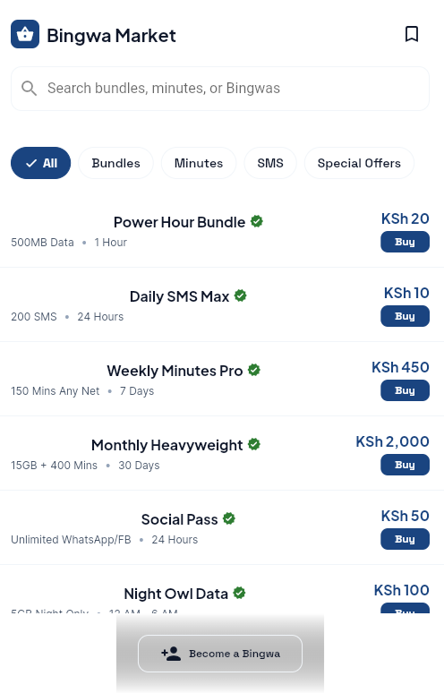
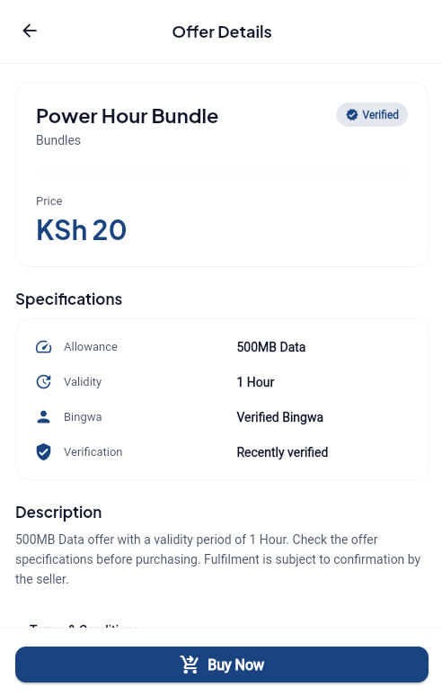
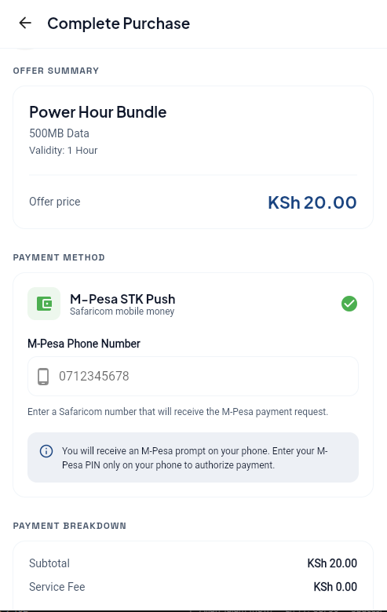
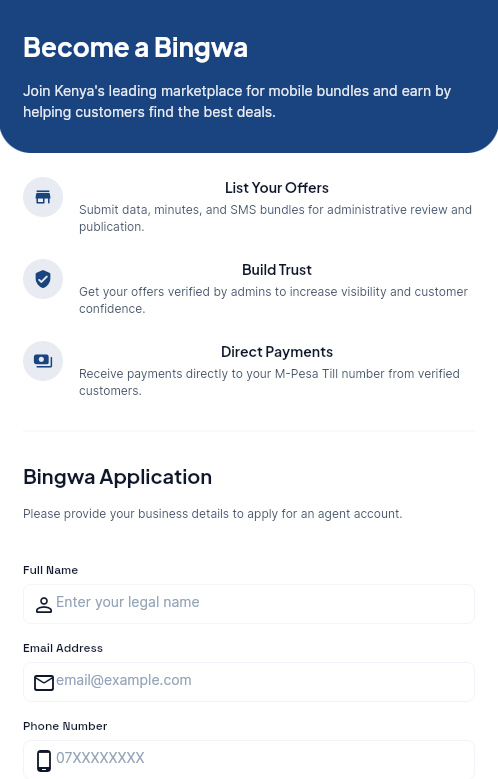

# Bingwa Market

**A Flutter-powered marketplace for discovering verified Bingwa Sokoni offers in Kenya.**

Bingwa Market is an independent platform designed to help customers discover offers from verified Bingwa Sokoni agents in one convenient place.

Customers can browse available offers, compare prices, view offer details and initiate purchases without creating an account.

## Project Overview

The goal is to build a trusted marketplace connecting customers with genuine Bingwa sellers while providing a simple and convenient purchasing experience.

## Current Features

- Browse mobile bundles, minutes, SMS and special offers.
- Search offers by name or keyword.
- Filter offers by category.
- View individual offer details.
- Display verified seller information (currently prototype data).
- Save offers and navigate between app screens.
- Enter and validate a Kenyan M-Pesa phone number.
- View a purchase confirmation before payment processing.

## Technology Stack

- **Flutter** – Cross-platform application development.
- **Dart** – Application programming language.
- **Git and GitHub** – Version control and project management.

## Planned Features

- Firebase Authentication for Bingwa sellers and administrators.
- Cloud Firestore for offers, sellers and transactions.
- Bingwa registration and seller verification.
- Admin dashboard for approving and managing sellers.
- Dynamic offer listings.
- M-Pesa Daraja API integration for secure payment processing.
- Purchase history and transaction tracking.
- Improved reporting and offer verification tools.
## App Screenshots

### Browse Offers


### Offer Details


### M-Pesa Purchase


### Bingwa Registration

## Current Development Status

The project is currently in the UI prototype and frontend development stage.

The customer browsing experience, offer details and M-Pesa purchase interface have been implemented and tested using sample data.

Backend services and real payment processing are planned for future development.

## Running the Project Locally

Make sure Flutter is installed, then run:

```bash
git clone https://github.com/allantalam/bingwa-market.git
cd bingwa-market
flutter pub get
flutter run -d chrome
```

## Project Roadmap

1. Complete and refine the frontend.
2. Connect Firebase and configure Firestore.
3. Implement Bingwa registration and admin approval.
4. Replace sample offers with live database records.
5. Integrate M-Pesa Daraja through a secure backend.
6. Test and prepare for production release.

## Developer

**Allan Talam**

GitHub: https://github.com/allantalam

---

*Bingwa Market — Discover offers. Buy with confidence.*